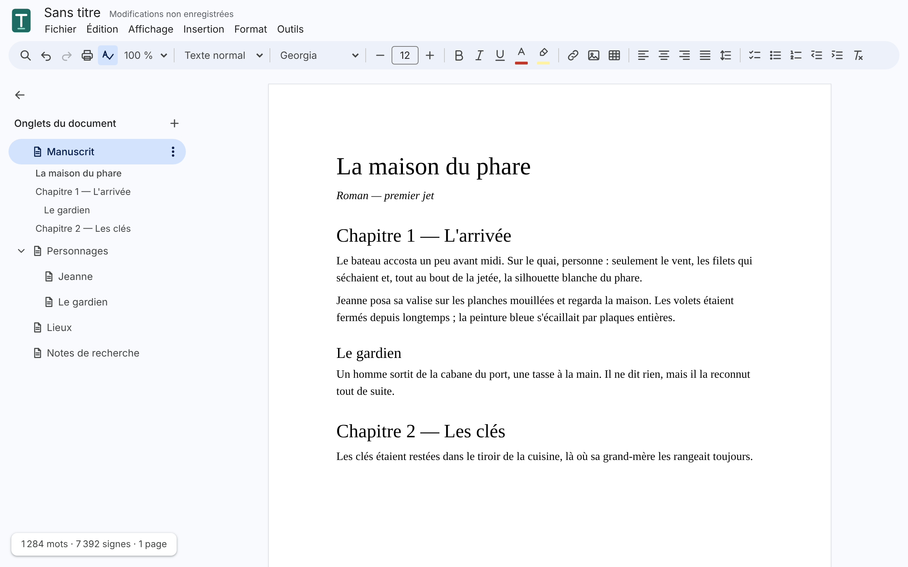

# Text Machine

Un traitement de texte **local**, inspiré de Google Docs, qui fonctionne
entièrement hors ligne. Vos documents restent sur votre ordinateur.



> **État :** MVP en construction. On peut écrire, mettre en forme
> (police, taille, couleurs, surlignage, liens, alignement, interligne,
> retraits, titres, listes et cases à cocher), insérer des tableaux et des
> images (depuis un fichier ou en les collant), enregistrer et rouvrir un
> document. Les pages s'affichent comme sur papier (A4 ou Lettre US,
> marges, sauts de page, numéros de page). Plan du document,
> rechercher/remplacer (⌘F) et correcteur orthographique du Mac.
> L'export PDF/Word, l'enregistrement automatique, etc. arrivent.

## Comment c'est construit

L'application a deux moitiés :

- **Le cœur, en Rust** (dossier `crates/`). Il connaît la structure d'un
  document, sait le modifier, l'enregistrer et l'ouvrir. Il ne dépend
  d'aucune interface : on pourra plus tard remplacer l'interface web par
  une interface 100 % native sans le réécrire.
- **L'interface** (dossier `app/`). Une fenêtre [Tauri](https://tauri.app)
  qui affiche un éditeur web [TipTap](https://tiptap.dev). TipTap gère la
  saisie au clavier ; il envoie le document au cœur Rust pour l'enregistrer,
  l'ouvrir ou compter les mots.

```
text-machine/
├── Cargo.toml            Liste des modules Rust (le « workspace »)
├── crates/
│   ├── tm-model/         Le modèle de document (paragraphes, titres, listes, gras…)
│   ├── tm-ops/           Les modifications du document et annuler / rétablir
│   └── tm-io-native/     Le format de fichier .tmd (provisoire)
└── app/
    ├── index.html        La fenêtre : barre d'outils, page, barre d'état
    ├── src/              Le code de l'éditeur web (TypeScript)
    └── src-tauri/        La coquille Tauri qui relie l'éditeur au cœur Rust
```

Le plan complet (fonctionnalités prévues, architecture, étapes) est dans le
document « Text Machine : fonctionnalités et structure du projet ».

## Installer l'application sur Mac (sans rien installer d'autre)

1. Téléchargez **[Text-Machine-mac.dmg](https://github.com/cosmicsoap/text-machine/releases/latest/download/Text-Machine-mac.dmg)**
   (toujours la dernière version, fabriquée automatiquement par GitHub).
   Elle marche sur les Mac Apple (M1, M2…) et Intel, macOS 11 ou plus récent.
2. Ouvrez le fichier `.dmg` et glissez **Text Machine** dans le dossier
   **Applications**.
3. **La première fois**, macOS bloque l'application, parce qu'elle n'est pas
   signée par Apple (il faut un compte développeur payant). Pour l'autoriser :
   - Double-cliquez sur Text Machine. Un message dit qu'Apple ne peut pas
     vérifier l'application : cliquez sur **Terminé** (ou **OK**).
   - Ouvrez **Réglages Système** > **Confidentialité et sécurité**,
     descendez tout en bas : à côté de « Text Machine a été bloquée »,
     cliquez sur **Ouvrir quand même**, puis confirmez avec votre mot de passe.
   - Sur macOS 14 ou plus ancien, plus simple : **clic droit** sur
     l'application > **Ouvrir** > **Ouvrir**.

   Ensuite, elle s'ouvre normalement, comme n'importe quelle application.

Si macOS dit que l'application « est endommagée », ouvrez le Terminal et
collez cette commande, puis relancez-la :

```sh
xattr -dr com.apple.quarantine "/Applications/Text Machine.app"
```

## Lancer l'application sur Mac (pour développer)

### 1. Installer les outils (une seule fois)

Ouvrez l'application **Terminal** et collez ces commandes une par une :

```sh
# Outils de développement d'Apple
xcode-select --install

# Rust
curl --proto '=https' --tlsv1.2 -sSf https://sh.rustup.rs | sh

# Node.js (il faut Homebrew : https://brew.sh)
brew install node
```

Fermez puis rouvrez le Terminal après l'installation de Rust.

### 2. Récupérer le projet

```sh
git clone https://github.com/cosmicsoap/text-machine.git
cd text-machine/app
npm install
```

### 3. Démarrer

Depuis le dossier `text-machine/app` :

```sh
npm run tauri dev
```

La première fois, la compilation prend quelques minutes. La fenêtre
s'ouvre ensuite toute seule. Les modifications du code web s'affichent
immédiatement ; celles du code Rust relancent l'application.

### Créer l'application installable

```sh
npm run tauri build
```

Le fichier `.app` (et un `.dmg`) se trouve ensuite dans
`target/release/bundle/macos/`.

## Lancer les tests

Depuis le dossier `text-machine` :

```sh
cargo test --workspace
```

## Questions encore ouvertes

- Format natif définitif : SQLite ou ZIP + JSON (pour l'instant, un fichier
  JSON `.tmd` ; seul `tm-io-native` changera).
- Pagination dès le MVP ou seulement à l'export PDF.
- Nom définitif et extension de fichier.
- Licence.
